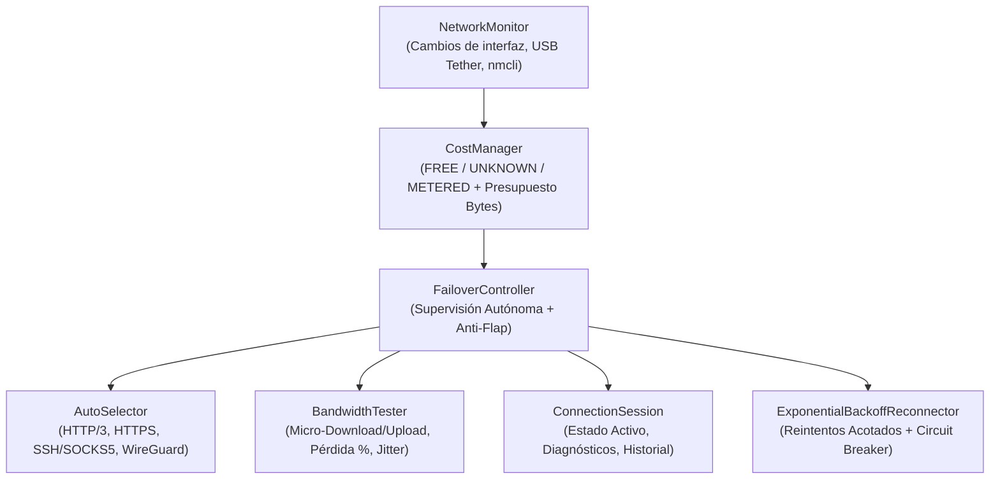

# JARO WPF — Documentación Técnica Fase 3: Intelligent Connectivity Core

## 1. Visión General de la Fase 3
La Fase 3 dota a JARO WPF de un núcleo autónomo de supervisión, selección y *failover* no disruptivo, sin interfaz gráfica aún y con huella mínima de CPU y RAM (< 48 MB RSS en Linux Mint 22.3).

---

## 2. Componentes Implementados

1. **[`core/connection/cost_manager.py`](file:///home/johanxinho/JARO-WPF/core/connection/cost_manager.py)**:
   - Perfiles explícitos `free`, `unknown` y `metered` configurables por interfaz (`configs/network_profiles.json`).
   - **Seguridad en Ethernet/Wi-Fi:** Nunca asume que una interfaz Ethernet (`enp1s0`) es gratuita por defecto (`unknown`), evitando consumir saldo si procede de un router móvil o *tethering*.
   - **Control de consumo:** Límite por prueba individual (`max_single_test_bytes`, 64 KB por defecto) y por sesión (`max_session_bytes`, 256 KB por defecto).
2. **[`core/connection/network_monitor.py`](file:///home/johanxinho/JARO-WPF/core/connection/network_monitor.py)**:
   - Detecta eventos `INTERFACE_ADDED`, `INTERFACE_REMOVED`, `LINK_DISCONNECTED`, `LINK_RECONNECTED`, `IP_ADDRESS_CHANGED`, `COST_PROFILE_CHANGED`, `ALL_NETWORKS_DISCONNECTED` y `NETWORK_CONNECTIVITY_RESTORED`.
   - Consulta `nmcli` (`GENERAL.METERED`) e identifica interfaces de *USB tethering* (`enp*u*`, `ipheth*`, `rndis*`).
3. **[`core/connection/auto_selector.py`](file:///home/johanxinho/JARO-WPF/core/connection/auto_selector.py)**:
   - Evalúa **únicamente transportes generales verificados** (`http3`, `https`, `ssh_socks5`, `wireguard`), rechazando/filtrando cualquier servicio DNS (`udp_dns`, `tcp_dns`, `dot`, `doq`).
   - Pondera 6 métricas en `[0..100]`: Coste (`25 pts`), Fiabilidad/Pérdida de paquetes + Estabilidad (`25 pts`), Latencia (`20 pts`), Velocidad (`20 pts`) y Jitter (`10 pts`).
4. **[`core/network_tests/bandwidth_tester.py`](file:///home/johanxinho/JARO-WPF/core/network_tests/bandwidth_tester.py)**:
   - Mide descarga, subida, latencia, *jitter* y pérdida de paquetes con micro-transferencias (`16 KB` bajada / `8 KB` subida) exclusivamente contra endpoints autorizados.
5. **[`core/connection/connection_session.py`](file:///home/johanxinho/JARO-WPF/core/connection/connection_session.py)** y **[`core/connection/failover_controller.py`](file:///home/johanxinho/JARO-WPF/core/connection/failover_controller.py)**:
   - Mantiene la sesión activa sin cortes innecesarios (`KEPT_HEALTHY_TRANSPORT`) mientras el chequeo ligero sea exitoso, y conmuta automáticamente (`AUTOMATIC_FAILOVER`) registrando cada transición en memoria y en `logs/failover_events.jsonl`.
